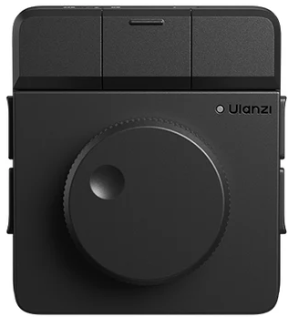

[English](README.md) | Español

# Ulanzi Dial

Configurador GTK4 + libadwaita (Rust) para el **Ulanzi Dial D100H** en Linux.



## Qué hace

- Lee el dial por **evdev** (el canal HID del kernel; el servicio GATT `0x1971`
  no es un canal de eventos en tiempo real — ver AetherSDR #3232).
- **Captura exclusiva** (`EVIOCGRAB`): las teclas multimedia que emite el
  firmware no se filtran a otras aplicaciones.
- Rueda (giro y pulsación) y 7 botones (3 superiores + 2 por lado)
  asignables, cada control con su propia acción.
- Acciones vía **uinput** (teclado/ratón virtual): volumen, brillo, scroll,
  zoom, pistas, deshacer/rehacer, copiar/pegar, captura, bloqueo, atajos y
  comandos personalizados.
- HUD en pantalla al girar (ventana flotante; ver limitación Wayland abajo).
- Config en `~/.config/ulanzi-dial/config.toml` (TOML legible, sin GSettings).

## Compilar y ejecutar

Dependencias de sistema:

```bash
# Fedora
sudo dnf install gtk4-devel libadwaita-devel rust cargo

# Debian/Ubuntu
sudo apt install libgtk-4-dev libadwaita-1-dev cargo
```

```bash
cargo run --release
```

## Instalar en el sistema (opcional)

```bash
install -Dm755 target/release/ulanzi-dial ~/.local/bin/ulanzi-dial
```

Entrada de menú en `~/.local/share/applications/dev.ulanzi.dial.desktop`:

```ini
[Desktop Entry]
Name=Ulanzi Dial
Comment=Configurador del Ulanzi Dial D100H (rueda y botones)
Exec=ulanzi-dial
Icon=dev.ulanzi.dial
Type=Application
Categories=GNOME;GTK;Utility;
StartupNotify=true
```

El icono va en `~/.local/share/icons/hicolor/256x256/apps/dev.ulanzi.dial.png`
(puedes recortarlo de `assets/device.png`).

## Permisos (necesario para evdev + uinput)

Sin permisos, la app no puede abrir `/dev/input/event*` ni escribir en
`/dev/uinput`.

Si tu usuario ya está en el grupo `input` y `/dev/uinput` es `root:input 660`,
no hay que hacer nada: comprueba con `id` y `ls -l /dev/uinput`.

En caso contrario, instala la regla udev incluida:

```bash
sudo cp udev/99-ulanzi-dial.rules /etc/udev/rules.d/
sudo udevadm control --reload-rules && sudo udevadm trigger
```

Cierra sesión y vuelve a entrar (o reinicia) para que surta efecto.

## Mapa de teclas del D100H

El mapa por defecto está medido en un D100H real (capturando evdev en
exclusiva, 27-Oct-2026):

| Control | Código que emite |
|---|---|
| Rueda a la derecha | `KEY_VOLUMEUP` |
| Rueda a la izquierda | `KEY_VOLUMEDOWN` |
| Pulsar la rueda | `KEY_MUTE` |
| Superior izquierdo | `KEY_PREVIOUSSONG` |
| Superior central | `KEY_PLAYPAUSE` |
| Superior derecho | `KEY_NEXTSONG` |
| Lateral izquierdo arriba | `Ctrl+V` |
| Lateral izquierdo abajo | `Ctrl+C` |
| Lateral derecho arriba | `Ctrl+Y` |
| Lateral derecho abajo | `Ctrl+Z` |

Tres particularidades de este firmware, medidas con el aparato en la mano:

- Suelta Ctrl antes que la letra del combo (el decoder resuelve la liberación
  por la tecla, no por el estado de Ctrl).
- No informa de una pulsación mantenida en la rueda: manda pulsación y
  liberación seguidas, así que no existe la pulsación larga.
- Mientras un botón está pulsado no emite giros: la rueda y los botones no se
  pueden combinar, así que cada uno tiene una sola acción.

Con el dial emparejado puedes comprobar el mapa en tu unidad:

```bash
evtest   # elige el dispositivo "Ulanzi Dial Keyboard"
```

Si tu unidad difiere, edita `~/.config/ulanzi-dial/config.toml`:

```toml
[keymap]
top-left = "Ctrl+X"
top-center = "Ctrl+C"
# claves: top-left, top-center, top-right,
#         side-left-upper, side-left-lower, side-right-upper, side-right-lower
```

## Volumen

Por defecto la rueda manda las teclas de volumen del sistema, así que se ve el OSD nativo del escritorio y el salto es el que tenga configurado (6% en GNOME, ajustable con `gsettings set org.gnome.settings-daemon.plugins.media-keys volume-step 3`).

Si prefieres un salto propio y no te importa perder el OSD del escritorio, el dial puede hablar directamente con PipeWire (`wpctl`) o PulseAudio (`pactl`) y aplicar el salto que le digas:

```toml
volume_mode = "mixer"   # "keys" (por defecto) o "mixer"
volume_step = 3         # puntos de volumen por muesca, solo en modo mixer
sensitivity = 5         # solo afecta a scroll, scroll horizontal y zoom
```

En modo `mixer` el HUD de la app muestra el volumen real que devuelve el mezclador, no un contador interno. Con `keys` el HUD no se muestra para el volumen porque el OSD del escritorio ya lo hace. La sensibilidad no multiplica el volumen ni el cambio de pista: era lo que hacía que una muesca saltara 30 puntos.

## Perfiles por aplicación

Cada aplicación puede tener sus propias asignaciones para los siete botones. La rueda (girar y pulsar) es siempre global: volumen y silencio tienen el mismo sentido en todas partes.

Crear un perfil es implícito: con la aplicación en primer plano, cambia una asignación en la pestaña Dispositivo y se guarda en el perfil de esa aplicación. Los botones que no toques siguen usando la asignación global.

Para que la app sepa qué ventana está activa hace falta una extensión de GNOME Shell, porque GNOME no permite a un programa normal consultarlo (la API de introspección de Mutter responde `AccessDenied` y Mutter no implementa `wlr-foreign-toplevel-management`):

```bash
mkdir -p ~/.local/share/gnome-shell/extensions/ulanzi-dial-focus@gnacho
cp gnome-extension/metadata.json gnome-extension/extension.js \
   ~/.local/share/gnome-shell/extensions/ulanzi-dial-focus@gnacho/
# actívala en la app Extensiones, o:
gnome-extensions enable ulanzi-dial-focus@gnacho
```

La extensión publica el identificador de la aplicación enfocada en el bus `dev.ulanzi.Dial.Focus`. Tras instalarla hay que cerrar y abrir sesión: en Wayland no se puede recargar GNOME Shell en caliente. Si la extensión no está o está desactivada, la app funciona igual y se queda en el perfil global, sin errores.

En la pestaña General puedes fijar un perfil a mano (`Global` o el de una aplicación concreta). El perfil fijado manda sobre la ventana activa.

## Comandos personalizados

Cualquier botón puede ejecutar un comando de shell. En la app, elige
"Ejecutar comando…" en el menú de acción del control y escríbelo: se ejecuta
con tu shell cada vez que pulses el control.

En `config.toml` esa asignación se guarda como tabla:

```toml
[buttons.side-right-upper]
press = { command = "gnome-calculator" }
```

Los atajos de teclado grabados se guardan igual:

```toml
[buttons.top-left]
press = { chord = "Ctrl+Shift+T" }
```

## Estructura

```
src/
  main.rs            entrada (adw::Application)
  config.rs          config.toml: carga/guardado, keymap overrides
  backend/
    keymap.rs        códigos físicos → identidad lógica (testeado)
    decoder.rs       eventos crudos → gestos semánticos (testeado)
    device.rs        evdev: detección, grab exclusivo, hotplug, batería
    focus.rs         sondeo D-Bus de la ventana activa (extensión de GNOME)
    actions.rs       ejecutor uinput + opciones de la UI (testeado)
  ui/
    mod.rs           ventana, ViewSwitcher, banner, toasts, cableado
    device_page.rs   pestaña Dispositivo (estado + mapa)
    control_map.rs   mapa OpenLogi (foto + líneas + tarjetas)
    general_page.rs  pestaña General (ruleta, comportamiento, perfil)
    chord_dialog.rs  diálogo de captura de atajos de teclado
    hud.rs           indicador en pantalla
assets/              foto frontal del D100H
gnome-extension/     extensión que publica la ventana activa
udev/                regla udev para permisos de input
```

## Limitaciones conocidas / hoja de ruta

- **Wayland**: el HUD es una ventana pequeña normal (sin `gtk4-layer-shell` no
  hay overlay real). Migrar el HUD a layer-shell es el primer candidato de
  mejora.
- **Perfiles por aplicación**: necesitan la extensión de GNOME (ver arriba),
  porque GNOME no expone la ventana activa a programas normales.
- **Ventana de tamaño fijo** (1020×760): el mapa usa geometría fija en v1.
- **Batería**: lectura best-effort del nodo `ABS_MISC` hermano (rango 0-255).
  Si el firmware no la expone limpiamente, simplemente no se muestra.
- UI en gtk4-rs imperativo; estructura pensada para migrar a **relm4**.

## Créditos

- Análisis del protocolo y mapa de teclas: AetherSDR #3232.
- Fotos del dispositivo: material del fabricante (Ulanzi), recortado para el mapa.
